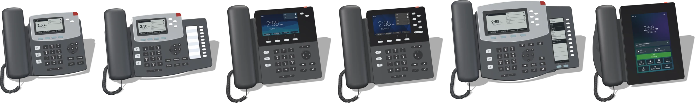

<p align="center">
  <a href="https://opendeskphone.org">
    <picture>
      <source media="(prefers-color-scheme: dark)" srcset="docs/src/assets/logo-dark.svg">
      
    </picture>
  </a>
</p>

<p align="center">
  <a href="https://opendeskphone.org"><b>opendeskphone.org</b></a>
  &nbsp;·&nbsp;
  <a href="https://opendeskphone.org/#installation">Install</a>
  &nbsp;·&nbsp;
  <a href="https://opendeskphone.org/open-dpma/">Open DPMA</a>
  &nbsp;·&nbsp;
  <a href="https://opendeskphone.org/app-sdk/">App SDK</a>
  &nbsp;·&nbsp;
  <a href="https://opendeskphone.org/dev-guide/">Dev Guide</a>
</p>

<p align="center">
  
</p>

Open Desk Phone is open-source firmware that replaces the stock firmware on the Digium D40, D45, D50, D60, D62, D65, and D70 desk phones.  Open Desk Phone can be installed as an ordinary firmware update over stock firmware.  Open Desk Phone is not affiliated with or endorsed by Digium or Sangoma.

On Asterisk, phones can be provisioned over DPMA.  Open Desk Phone includes an [open-source DPMA re-write](#open-dpma) in this repository.  Without DPMA provisioning, Open Desk Phone can work like a standard SIP phone, with accounts added in the web interface.

## Install

Put the `.eff` file for each phone model from [Releases](https://github.com/jackrosenthal/opendeskphone/releases) where phones download firmware (`file_url_prefix`), and add a firmware entry for each model to `res_digium_phone.conf`:

```ini
[fw-d65]
type=firmware
model=D65
version=3_0_0
file=3_0_0_D65_firmware.eff

[phone101]
type=phone
; ...the phone's existing options...
firmware=fw-d65
```

```sh
asterisk -rx 'module reload'
asterisk -rx 'digium_phones reconfigure all'
```

Phones install Open Desk Phone when they fetch the new configuration.

## Open DPMA

Open DPMA is a drop-in replacement, written in Rust, for Digium's closed-source DPMA module, with fixes for several bugs and security issues.  Open DPMA supports Asterisk 22, 23, and 24, reads the same `res_digium_phone.conf`, and registers the same CLI commands and AMI actions.  Phones on stock firmware and phones on Open Desk Phone both work with Open DPMA.

To switch from Digium's module, download Open DPMA for your Asterisk version and architecture:

| | x86_64 | aarch64 |
|---|---|---|
| Asterisk 22 | [res_open_dpma-asterisk22-x86_64.so](https://github.com/jackrosenthal/opendeskphone/releases/latest/download/res_open_dpma-asterisk22-x86_64.so) | [res_open_dpma-asterisk22-aarch64.so](https://github.com/jackrosenthal/opendeskphone/releases/latest/download/res_open_dpma-asterisk22-aarch64.so) |
| Asterisk 23 | [res_open_dpma-asterisk23-x86_64.so](https://github.com/jackrosenthal/opendeskphone/releases/latest/download/res_open_dpma-asterisk23-x86_64.so) | [res_open_dpma-asterisk23-aarch64.so](https://github.com/jackrosenthal/opendeskphone/releases/latest/download/res_open_dpma-asterisk23-aarch64.so) |
| Asterisk 24 | [res_open_dpma-asterisk24-x86_64.so](https://github.com/jackrosenthal/opendeskphone/releases/latest/download/res_open_dpma-asterisk24-x86_64.so) | [res_open_dpma-asterisk24-aarch64.so](https://github.com/jackrosenthal/opendeskphone/releases/latest/download/res_open_dpma-asterisk24-aarch64.so) |

Then, replace Digium's module and restart Asterisk:

```sh
cp res_open_dpma-asterisk*.so /usr/lib/asterisk/modules/res_open_dpma.so
cd /usr/lib/asterisk/modules
rm res_digium_phone.so res_pjsip_endpoint_identifier_dpma.so res_pjsip_dialog_info_digium_body_supplement.so
systemctl restart asterisk
```

## Web interface

<p align="center">
  <picture>
    <source media="(prefers-color-scheme: dark)" srcset=".github/readme/web-dashboard-dark.webp">
    
  </picture>
  <picture>
    <source media="(prefers-color-scheme: dark)" srcset=".github/readme/web-screen-dark.webp">
    
  </picture>
  <picture>
    <source media="(prefers-color-scheme: dark)" srcset=".github/readme/web-calls-dark.webp">
    
  </picture>
  <picture>
    <source media="(prefers-color-scheme: dark)" srcset=".github/readme/web-apps-dark.webp">
    
  </picture>
</p>

Open Desk Phone includes a web interface in the firmware which manages calls, Bluetooth headsets (D65), alarms, apps, and firmware, and can mirror the phone screen, with keys you can click to operate the phone.

## Apps

<p align="center">
  
  
  
  
  
  
</p>

Open Desk Phone supports [WASM-based applications](https://opendeskphone.org/app-sdk/).  Several examples are included in this repository under [`apps/`](apps/).  With Open DPMA, apps can keep data on the PBX that every phone shares.

## Development

See the [Dev Guide](https://opendeskphone.org/dev-guide/) to build Open Desk Phone from source.
